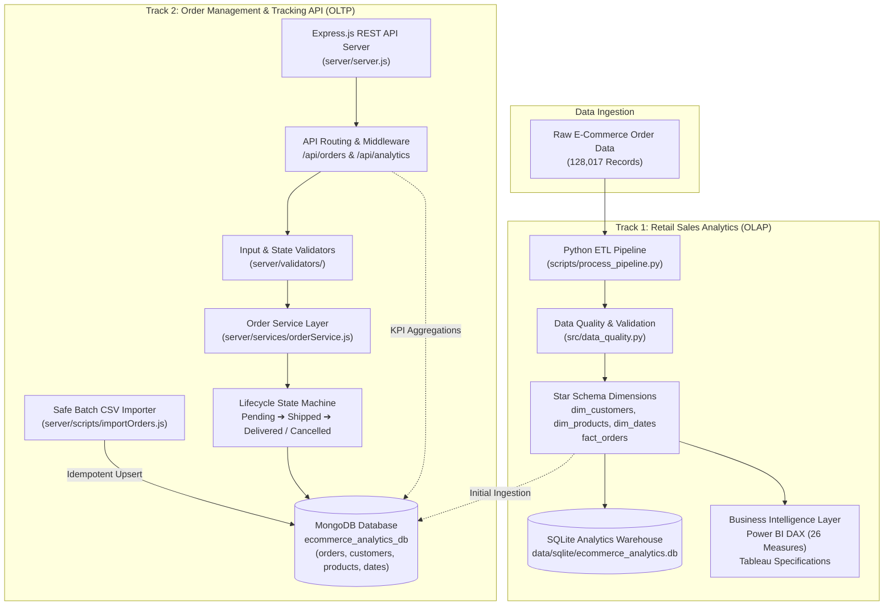

# E-Commerce Analytics & Order Management Platform

[](https://nodejs.org/)
[](https://expressjs.com/)
[](https://www.mongodb.com/)
[](https://www.python.org/)
[](https://www.sqlite.org/)
[](https://pytest.org/)
[](https://nodejs.org/api/test.html)
[](https://powerbi.microsoft.com/)

An enterprise-ready portfolio project showcasing two complementary engineering and analytical capabilities on real-world e-commerce transactional data:

1. **Retail Sales & Market Basket Analytics (OLAP / Data Engineering):** A reproducible Python ETL pipeline, star-schema dimensional warehouse (SQLite & MongoDB), comprehensive DAX measure library (26 measures), and BI dashboard blueprints (Power BI & Tableau) for analyzing revenue, customer lifetime value, and order fulfillment.
2. **E-Commerce Order Management & Tracking API (OLTP / Backend Engineering):** A production-grade Node.js/Express RESTful service with MongoDB persistence, strict state-machine order lifecycle transitions, soft/hard deletion policies, multi-criteria filtering, input boundary validation, and a non-destructive batch CSV streaming importer.

---

## 🏛️ System Architecture



---

## 🚀 Key Capabilities & Modules

### Track 1: Retail Sales & Market Basket Analytics
- **Star Schema Dimensional Model:** Normalizes transactional lines into a high-performance star schema (`fact_orders`, `dim_customers`, `dim_products`, `dim_dates`) supporting high-speed OLAP slicing and aggregation.
- **Data Quality & Validation:** Automated reconciliation between Python Pandas aggregates and SQLite SQL queries (`src/analytics_validation.py`) with zero metric drift.
- **DAX Measures Library:** 26 production-grade measures covering Gross Merchandise Value (GMV), Net Realized Revenue, Units Sold, Average Order Value (AOV), Return Rates, and Month-over-Month variances ([powerbi/measures/dax_measures_library.dax](powerbi/measures/dax_measures_library.dax)).
- **BI Design Blueprints:** 4-page executive dashboard layout specifications for Power BI Desktop and Tableau storyboards ([powerbi/dashboard_documentation/](powerbi/dashboard_documentation/) and [tableau/dashboards/](tableau/dashboards/)).

### Track 2: E-Commerce Order Management & Tracking API
- **Full CRUD REST Endpoints:** Full operational lifecycle support for creating, retrieving, updating, and deleting orders with unique `order_item_id` generation.
- **Order Lifecycle State Machine:** Strict progression rules prevent illegal states:
  - `Pending` $\rightarrow$ `Shipped`, `Cancelled`
  - `Shipped` $\rightarrow$ `Delivered`, `Returned`, `Cancelled`
  - `Delivered` $\rightarrow$ `Returned`
  - `Cancelled` / `Returned` $\rightarrow$ Terminal states (subsequent status modifications return `400 Bad Request`).
- **Audit-Safe Deletion Policy:** Default soft-delete (`is_deleted: true`) hides records from customer search while maintaining historical financial audit trails. Hard deletion available via `?hard=true`.
- **Soft-Delete Aware Aggregations:** MongoDB analytics pipelines (`pipelineExecutiveKPIs`, etc.) explicitly filter `{ $match: { is_deleted: { $ne: true } } }` so deleted test orders never distort revenue or order counts.
- **Safe CSV Batch Importer:** Streaming importer with `--dry-run` validation and idempotent source-keyed upserts (`bulkWrite`) guaranteeing zero collection overwrites or data loss.

---

## 📊 Verified Data Snapshot & Metrics

The following metrics have been verified against the cleaned dataset (`data/cleaned/fact_orders.csv`) and SQLite database with automated test reconciliation. **Note:** The cleaned CSV files and local SQLite database are excluded from Git (see `.gitignore`); they are generated locally by the ETL pipeline and are not present in a fresh clone.

| Metric | Verified Value | Scope / Methodology |
| :--- | :---: | :--- |
| **Total Fact Rows (Order Items)** | `128,017` | Total individual item lines evaluated |
| **Distinct Parent Orders** | `120,229` | Unique `Order_ID` transactions in historical dataset |
| **Net Realized Sales** | `₹69,392,224.00` | Realized revenue from `Delivered` and `Shipped` orders |
| **Units Sold** | `107,266` | Physical units successfully shipped/delivered |
| **Average Order Value (AOV)** | `₹577.17` | Realized revenue divided by distinct parent order count |
| **Customer Accounts** | `14,813` | Distinct customers in `dim_customers` |
| **Catalog SKUs** | `45` | Unique product items in `dim_products` |
| **Calendar Span** | `121 Days` | Q2 2022 daily dimension in `dim_dates` |

> [!NOTE]
> **Model Assumptions:** `Net_Sales` represents realized transactions (set to ₹0.00 for cancelled/returned orders). `COGS` is modeled at 65% of net sales for analytical demonstration. Customer names and identities are synthetic tokens (`CUST-XXXXX`) to preserve privacy.

---

## 📡 REST API Reference

The backend operates on `http://localhost:5000` (configurable via `PORT` in `server/.env`).

### Core Endpoints

| Method | Endpoint | Description | Query Parameters / Payload |
| :---: | :--- | :--- | :--- |
| `GET` | `/health` | Service health & database connectivity | None |
| `GET` | `/api/orders` | Paginated, filtered, and sorted order list | `page`, `limit`, `status`, `region`, `customerId`, `productId`, `sortBy`, `order`, `search`, `startDate`, `endDate` |
| `POST` | `/api/orders` | Create a new order item | JSON body with `order_id`, `customer_id`, `product_id`, `quantity`, `unit_price`, etc. |
| `GET` | `/api/orders/:orderId` | Retrieve order by `order_id` or `order_item_id` | Path param `:orderId` |
| `PATCH` | `/api/orders/:orderId` | Update mutable order details | JSON body with mutable fields (`quantity`, `unit_price`, `ship_city`, etc.) |
| `PATCH` | `/api/orders/:orderId/status`| Update status via state machine | JSON body: `{ "status": "Shipped" }` |
| `DELETE`| `/api/orders/:orderId` | Delete order (soft by default; `?hard=true`) | Query param `?hard=true` (optional) |
| `GET` | `/api/analytics/kpis` | Executive summary KPIs (excludes deleted) | None |
| `GET` | `/api/analytics/*` | Aggregations (monthly, category, regional) | None |

---

### Verified Request & Response Examples

#### 1. Create Order (`POST /api/orders`)
**Request:**
```http
POST /api/orders HTTP/1.1
Host: localhost:5000
Content-Type: application/json

{
  "order_id": "ORD-2026-8801",
  "customer_id": "CUST-10492",
  "product_id": "PROD-TSH-L",
  "quantity": 2,
  "unit_price": 450.0,
  "order_status_group": "Pending",
  "fulfilment_method": "Amazon",
  "ship_city": "Bengaluru",
  "ship_state": "Karnataka",
  "region": "South",
  "is_b2b": false
}
```
**Response (`201 Created`):**
```json
{
  "success": true,
  "message": "Order created successfully.",
  "data": {
    "order_item_id": "ITEM-c4b8e219-...",
    "order_id": "ORD-2026-8801",
    "customer_id": "CUST-10492",
    "product_id": "PROD-TSH-L",
    "quantity": 2,
    "unit_price": 450.0,
    "gross_amount": 900.0,
    "net_sales": 0.0,
    "order_status_group": "Pending",
    "is_deleted": false,
    "created_at": "2026-10-19T14:30:00.000Z",
    "updated_at": "2026-10-19T14:30:00.000Z"
  }
}
```

#### 2. Query Orders with Bounded Pagination (`GET /api/orders`)
**Request:**
```http
GET /api/orders?page=1&limit=2&status=Delivered&region=South&sortBy=gross_amount&order=desc HTTP/1.1
Host: localhost:5000
```
**Response (`200 OK`):**
```json
{
  "success": true,
  "pagination": {
    "page": 1,
    "limit": 2,
    "total": 5420,
    "totalPages": 2710,
    "hasNextPage": true,
    "hasPrevPage": false
  },
  "data": [
    {
      "order_item_id": "ITEM-100002",
      "order_id": "171-9198151-1101146",
      "customer_id": "CUST-11687",
      "product_id": "PROD-SHT-3XL",
      "order_status_group": "Delivered",
      "quantity": 1,
      "gross_amount": 406.0,
      "net_sales": 406.0,
      "region": "South"
    }
  ]
}
```

#### 3. Update Order Status with State Machine (`PATCH /api/orders/:orderId/status`)
**Permitted Transition (`Pending` $\rightarrow$ `Shipped`):**
```json
// Request
PATCH /api/orders/ORD-2026-8801/status
{ "status": "Shipped" }

// Response (200 OK)
{
  "success": true,
  "message": "Order status updated successfully.",
  "data": {
    "order_id": "ORD-2026-8801",
    "order_status_group": "Shipped",
    "courier_status": "Shipped"
  }
}
```

**Rejected Terminal Transition (`Cancelled` $\rightarrow$ `Delivered`):**
```json
// Response (400 Bad Request)
{
  "success": false,
  "error": "Cannot transition order status from 'Cancelled' to 'Delivered'. Allowed transitions: none (terminal state)."
}
```

#### 4. Safe Soft Deletion (`DELETE /api/orders/:orderId`)
```json
// Response (200 OK)
{
  "success": true,
  "message": "Order deleted successfully (soft-deleted).",
  "data": {
    "deleted": true,
    "order_id": "ORD-2026-8801",
    "hard": false
  }
}
```
*(Subsequent lookups for `ORD-2026-8801` return `404 Not Found`, and analytical queries automatically exclude it).*

---

## 📂 Repository Structure

```text
amazon_mongo_project/
├── app/                              # Streamlit interactive analytics app
├── data/                             # Data layer (clean, raw, validation)
│   ├── validation/                   # Reconciliation reports (Python vs SQLite)
│   └── (large CSVs excluded from Git; see Setup Guide)
├── docs/                             # Engineering specifications & handoff docs
│   ├── api_documentation.md          # REST API reference and payload schemas
│   ├── database_schema.md            # MongoDB collection & index architecture
│   ├── implementation_progress.md    # Multi-phase milestone progress log
│   └── final_validation_report.md    # Final reconciliation metrics & smoke tests
├── documentation/                    # Analytical research & data cleaning audits
├── excel/                            # Cleaned Excel workbooks and data dictionary
├── insights/                         # Executive business summaries & findings
├── mongodb/                          # Database indexing & aggregation pipelines
│   ├── aggregation_queries.js        # Analytics pipelines (with soft-delete filter)
│   ├── create_indexes.js             # Strategic index creation script
│   └── import_data.js                # Star schema MongoDB ingestion module
├── powerbi/                          # Power BI assets
│   ├── measures/dax_measures_library.dax  # 26 production-grade DAX measures
│   ├── dashboard_documentation/      # Visual layouts & KPI specifications
│   └── data_model/                   # Star-schema modeling guides
├── scripts/                          # Analytics CLI & processing scripts
│   ├── process_pipeline.py           # Core ETL cleaning & dimensional star schema
│   └── importOrders.js               # CLI proxy for CSV batch importer
├── server/                           # Express.js REST API Backend
│   ├── config/database.js            # MongoDB connection manager (masked logs)
│   ├── controllers/orderController.js # HTTP request handler
│   ├── middleware/                   # Validation & error handling middleware
│   ├── models/Order.js               # Order schema & lifecycle state machine
│   ├── routes/orderRoutes.js         # REST route definitions
│   ├── routes/analytics.js           # Analytics aggregation routes
│   ├── services/orderService.js      # Business logic & query builder
│   ├── validators/orderValidator.js  # Input & boundary validation
│   ├── scripts/importOrders.js       # Streaming batch upsert importer (--dry-run)
│   ├── test/                         # Node.js automated test suites (34 tests)
│   ├── package.json                  # Server dependencies & scripts
│   └── .env.example                  # Environment configuration template
├── src/                              # Python analytical validation pipeline
│   ├── analytics_validation.py       # SQL vs Pandas dual-calculation checker
│   ├── data_quality.py               # Dataset quality report generator
│   └── mongo_validation.py           # Read-only MongoDB validation
├── tableau/                          # Tableau storyboards & visual specifications
├── tests/                            # Pytest test suite (27 automated tests)
├── .gitignore                        # Git exclusion rules
├── README.md                         # Project documentation
└── requirements.txt                  # Python dependencies
```

---

## 🛡️ Security & Git Exclusion Policy

To adhere to industry best practices, the following assets are **intentionally excluded from Git tracking** via [.gitignore](.gitignore):

1. **Credentials & Secrets (`.env`, `server/.env`):** Prevents accidental leakage of MongoDB Atlas connection strings, passwords, or cloud API keys. A template is provided at [server/.env.example](server/.env.example).
2. **Third-Party Dependencies (`node_modules/`, `.venv/`):** Kept local; installed deterministically via `npm install` and `pip install -r requirements.txt`.
3. **Local Databases (`data/sqlite/*.db`):** Binary SQLite warehouse is generated deterministically by the ETL pipeline.
4. **Large Datasets (`*.csv` > 15MB):** Raw datasets and 128,017-row CSV exports are excluded to prevent repository bloat and Git LFS bandwidth exhaustion. All pipelines generate or consume them locally.

---

## ⚙️ Setup and Installation Guide

### Prerequisites
- **Node.js** (v18.0.0 or higher) & **npm**
- **Python** (v3.10 or higher) with `pip`
- **MongoDB** (Local instance at `mongodb://localhost:27017` or MongoDB Atlas cluster)

---

### Step 1: Clone Repository
```powershell
git clone https://github.com/geepikagarike/Amazon-Sales-Report.git
cd Amazon-Sales-Report
```

---

### Step 2: Python Analytics Pipeline Setup
```powershell
# 1. Create and activate a Python virtual environment
python -m venv .venv
.\.venv\Scripts\Activate.ps1

# 2. Install dependencies
pip install -r requirements.txt

# 3. Run automated analytics tests (100% offline, 27 passed)
python -m pytest -q
```

---

### Step 3: Node.js Order Management API Setup
```powershell
# 1. Navigate to server directory
cd server

# 2. Install dependencies
npm install

# 3. Run automated backend test suite (100% offline, 34 passed)
npm test

# 4. Configure environment variables
Copy-Item .env.example .env
```

Edit `server/.env` with your desired configuration:
```ini
PORT=5000
NODE_ENV=development
MONGO_URI=mongodb://localhost:27017
DB_NAME=ecommerce_analytics_db
```

---

### Step 4: Database Setup & Safe CSV Import (Optional / Local MongoDB)

> [!IMPORTANT]
> The source CSV (`data/cleaned/amazon_sales_cleaned.csv`) and local SQLite database (`data/sqlite/ecommerce_analytics.db`) are **excluded from Git** and will not be present in a fresh clone. Run the Python ETL pipeline (Step 2) first, or obtain the cleaned CSV separately, before executing the import commands below.

```powershell
# 1. Create strategic indexes in MongoDB (run from server/ directory)
npm run create-indexes

# 2. Verify CSV importer in dry-run mode (Zero database writes)
npm run import-orders:dry-run

# 3. Import historical order items via non-destructive batch upsert
npm run import-orders
```

---

### Step 5: Start the API Server
```powershell
# Start in development mode with auto-reload
npm run dev

# Or start in standard production mode
npm start
```

Verify service status:
```powershell
Invoke-RestMethod -Uri "http://localhost:5000/health" -Method Get
```

---

## 🧪 Verified Test Suite Summary

All test suites execute **100% offline** using mock database drivers and require zero network access or active database credentials:

| Test Suite | Framework | Scope | Result | Execution Time |
| :--- | :---: | :--- | :---: | :---: |
| **Node.js Backend Tests** | Node Test Runner (`node --test`) | Full CRUD, State Machine, Bounded Pagination, Soft/Hard Delete, Error Masking, CSV Importer | **34 Passed, 0 Failed** | ~750ms |
| **Python Analytics Tests** | `pytest` | ETL Cleaning, Star Schema Integrity, SQL Analytics, Dual-Engine Reconciliation | **27 Passed, 0 Failed** | ~17s |

---

## 👤 Author & Portfolio Context

- **Developer:** [Geepika Garike](https://github.com/geepikagarike)
- **Repository:** [Amazon-Sales-Report](https://github.com/geepikagarike/Amazon-Sales-Report)
- **Demonstrated Skills:**
  - **Backend Software Engineering:** Node.js, Express.js, RESTful API Design, State Machines, MongoDB Native Driver, Automated Testing, Security Best Practices.
  - **Data Engineering & Analytics:** Python, Pandas, SQLite, Star Schema Dimensional Modeling, DAX, Power BI, Tableau, ETL Pipeline Architecture.
