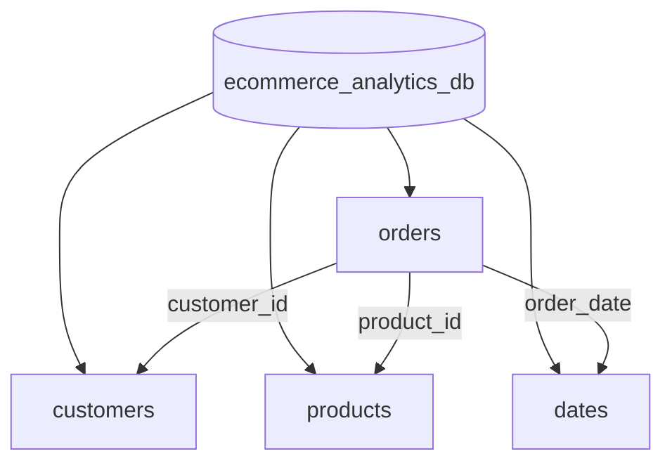

# MongoDB Analytics & Aggregation Pipelines Guide

## 1. MongoDB Database & Collection Architecture

Database Name: `ecommerce_analytics_db`

### Collections

1. **`orders`**: Fact collection holding all transactional order lines (128,017 documents).
2. **`customers`**: Dimension collection with customer profiles, lifetime spend, and RFM spending tiers (14,813 documents).
3. **`products`**: Dimension collection containing apparel SKUs, categories, sizes, and pricing (45 documents).
4. **`dates`**: Dimension collection containing calendar dates and hierarchies (120 documents).

---

## 2. Index Strategy for High-Performance Queries

To ensure sub-millisecond query execution on 128k+ records, we implemented:

1. **Primary & Unique Indexes**:
   - `orders.order_item_id` (Unique)
   - `customers.customer_id` (Unique)
   - `products.product_id` (Unique)
2. **Compound Analytical Indexes**:
   - `{ order_status_group: 1, net_sales: -1 }`: Accelerates revenue calculations and status funnel filtering.
   - `{ customer_id: 1, order_date: -1 }`: Optimizes customer purchase history lookups.
   - `{ region: 1, ship_state: 1, net_sales: -1 }`: Powers geographic analytics aggregations.
   - `{ customer_segment: 1, total_spend: -1 }`: Speeds up RFM customer segmentation queries.

---

## 3. MongoDB Aggregation Pipelines Summary

| # | Pipeline Name | Business Question Answered | Key Aggregation Stages |
| :--- | :--- | :--- | :--- |
| **1** | `pipelineExecutiveKPIs` | What is our total revenue, order count, items sold, and AOV? | `$group` (null), `$addToSet`, `$project`, `$divide` |
| **2** | `pipelineMonthlySalesTrend` | How is revenue and order volume trending month-over-month? | `$group` (year, month), `$project`, `$sort` |
| **3** | `pipelineCategoryPerformance` | Which product categories contribute most to net revenue? | `$lookup` (products), `$unwind`, `$group` (category), `$sort` |
| **4** | `pipelineTopProducts` | What are our top 10 best-selling apparel SKUs? | `$lookup` (products), `$group` (product_id), `$sort`, `$limit` 10 |
| **5** | `pipelineTopCustomers` | Who are our top 10 highest-spending customer accounts? | `$group` (customer_id), `$lookup` (customers), `$sort`, `$limit` 10 |
| **6** | `pipelineCustomerSegmentation` | How is customer spend distributed across RFM tiers? | `$group` (customer_segment), `$avg`, `$project`, `$sort` |
| **7** | `pipelineOrderStatusFunnel` | What is our delivery success rate vs cancellation rate? | `$group` (order_status_group), `$sum`, `$project` |
| **8** | `pipelineRegionalSales` | Which regions and states drive the highest sales? | `$group` (region, state), `$sort`, `$project` |
| **9** | `pipelineFulfilmentChannel` | How does Amazon FBA compare against Merchant fulfillment? | `$group` (fulfilment_method), `$project`, `$sort` |
| **10** | `pipelineUnderperformingProducts` | Which SKUs suffer from zero or low sales volume? | `$group`, `$lookup`, `$sort` (ascending), `$limit` 10 |
