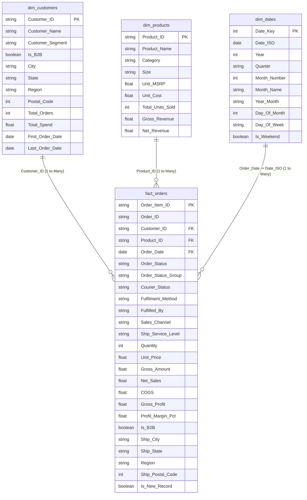

# Power BI Star Schema Data Model Architecture

## 1. Architectural Overview

The analytical data model implements a **Kimball-style dimensional Star Schema** optimized for analytical reporting, aggregation speed, and enterprise scalability in Power BI.

The model segregates **business events (Transactions/Orders)** from **contextual entities (Customers, Products, Dates, Geography)**.

---

## 2. Table Specifications & Cardinalities

| From Table (Dimension) | Key Column | To Table (Fact) | Foreign Key Column | Cardinality | Cross-Filter Direction | Relationship Type |
| :--- | :--- | :--- | :--- | :--- | :--- | :--- |
| **`dim_customers`** | `Customer_ID` | **`fact_orders`** | `Customer_ID` | 1 to Many (`1:*`) | Single (Dim filters Fact) | Active |
| **`dim_products`** | `Product_ID` | **`fact_orders`** | `Product_ID` | 1 to Many (`1:*`) | Single (Dim filters Fact) | Active |
| **`dim_dates`** | `Date_ISO` | **`fact_orders`** | `Order_Date` | 1 to Many (`1:*`) | Single (Dim filters Fact) | Active |

---

## 3. Design Principles & Best Practices Applied

1. **Strict 1:Many Relationships**: Eliminates ambiguous many-to-many paths, avoiding Cartesian product inflation and performance bottlenecks.
2. **Single Direction Filtering**: All filters flow unidirectionally from Dimension tables to Fact tables, preventing circular filter dependencies.
3. **Surrogate Keys**: Tables are joined on lightweight, clean surrogate keys (`Customer_ID`, `Product_ID`, `Date_ISO`).
4. **Separation of Concerns**:
   - `fact_orders` holds all quantitative additive measures (`Quantity`, `Gross_Amount`, `Net_Sales`, `COGS`, `Gross_Profit`).
   - Dimension tables hold qualitative attributes for slicing, dicing, and grouping.
5. **Marked Date Table**: `dim_dates` is designated as the official Date Table in Power BI, enabling accurate time-intelligence DAX functions (`SAMEPERIODLASTYEAR`, `DATESMTD`, `DATEADD`).
